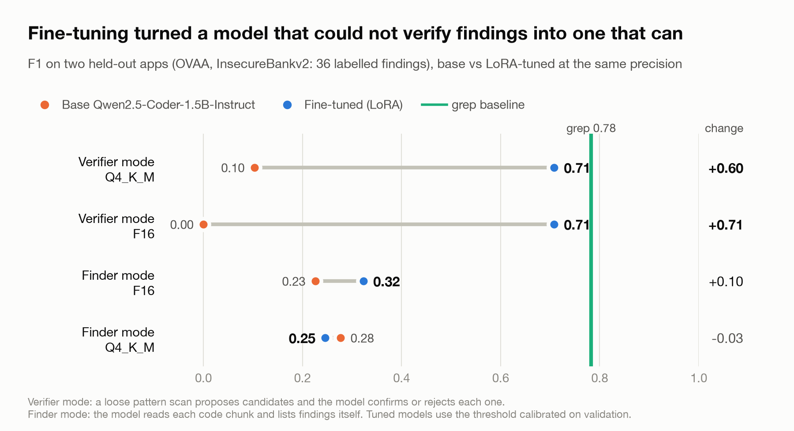
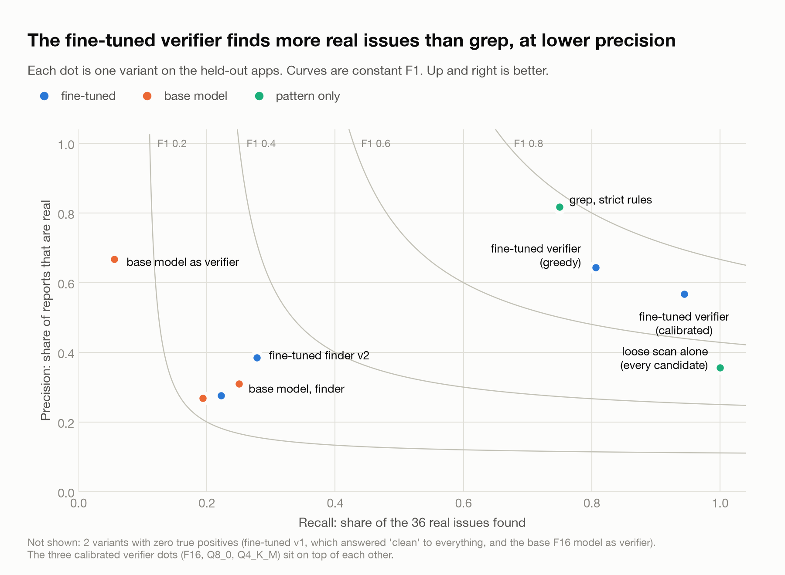
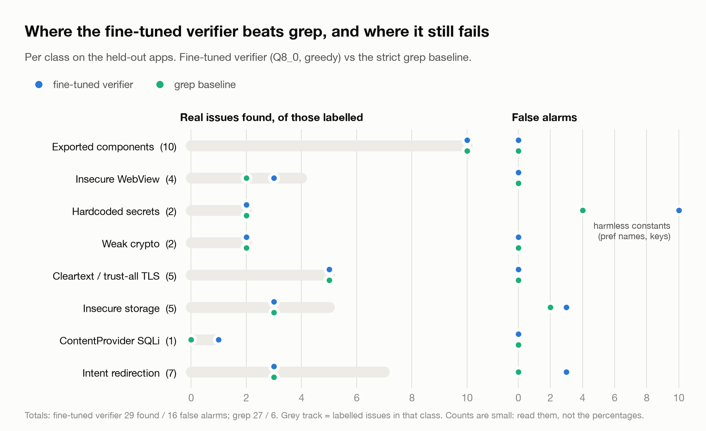
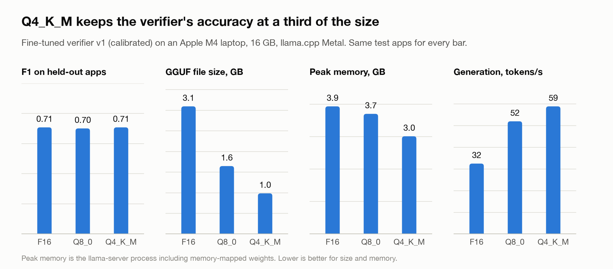
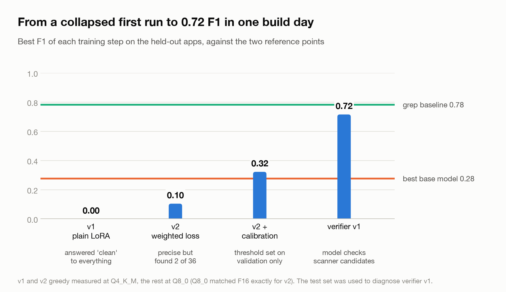

# apkscan-local, by team MNM

**Offline Android vulnerability triage with a fine-tuned Qwen2.5-Coder-1.5B. It decompiles an APK, proposes candidate issues with a loose pattern scanner, and the fine-tuned Qwen decides which ones are real, on a 16 GB laptop with no network calls.**

| | |
|---|---|
| Base model | [Qwen/Qwen2.5-Coder-1.5B-Instruct](https://huggingface.co/Qwen/Qwen2.5-Coder-1.5B-Instruct), Apache-2.0, revision 2e1fd397 |
| Method | LoRA (rank 16) with MLX-LM 0.32.2, decision-weighted loss, trained on the laptop below |
| Quantization | GGUF Q8_0 (1.6 GB, used in the video) and Q4_K_M (1.0 GB) |
| Runtime | llama.cpp b10210 (`llama-server`, Metal), bound to 127.0.0.1, no network calls |
| Hardware for training and every number | Apple M4 (4 performance and 6 efficiency cores), 16 GB unified memory, macOS 27.2.1 |
| Fine-tuned model (GGUF + LoRA adapter) | Hugging Face: [hwatsauce/apkscan-local](https://huggingface.co/hwatsauce/apkscan-local) |
| Demo video | YouTube: [https://www.youtube.com/watch?v=BUchPPf7S3A](https://www.youtube.com/watch?v=BUchPPf7S3A) |
| Evidence repository | GitHub: [iabdullah215/apkscan-local](https://github.com/iabdullah215/apkscan-local) |
| Team | MNM (solo): [iabdullah215](https://github.com/iabdullah215) |

Every number below is a real measurement on two apps the model never saw in training, including what still fails.

## The result in one picture

<picture>
  <source media="(prefers-color-scheme: dark)" srcset="charts/01-base-vs-tuned-dark.png">
  
</picture>

On two held-out apps (OVAA 1.0.0 and InsecureBankv2, 36 hand-labelled vulnerabilities), the untuned Qwen confirms almost nothing. The same model after LoRA finds 29 of 36 at Q8_0, or 34 of 36 at Q4_K_M with the validation-calibrated threshold.

## What it does

The user is a developer or a security reviewer who has an APK and no budget to send it to a cloud service. The tool takes the APK and returns a report of confirmed findings, each with a severity, a CWE, the evidence line, why it is exploitable and a suggested fix.

```
app.apk -> jadx decompile -> app files only (libraries skipped), original line numbers kept
        -> loose pattern scanner: every suspicious line becomes a candidate (high recall, mostly false alarms)
        -> fine-tuned Qwen verifier via llama-server on 127.0.0.1: {"real": true/false, severity, cwe, evidence, why, fix}
        -> confirmed findings -> JSON + Markdown report
```

It covers 8 classes: exported components, insecure WebView, hardcoded secrets, weak crypto, cleartext or trust-all TLS, insecure storage, ContentProvider SQL injection and intent redirection, each mapped to a CWE and an OWASP MASVS v2 control. It explains and suggests fixes; it never writes exploits.

## Why we built it

APK review is the part of mobile security work that stalls first. A pattern scanner alone is unusable: on the two test apps it raised 101 candidates for 36 real issues, so a reviewer reads 65 false alarms. A cloud model solves the judgement problem but means uploading a client's unreleased app, which is often not allowed.

Fine-tuning was the right tool because the untuned model does not do the task at all, not because it is slow or verbose. Prompting failed in a specific, measurable way: asked to decide on a candidate, the base model answered `{"real": false}` to every one of the 129 candidates in both test apps, and produced strict JSON 0 to 2% of the time. There was nothing to tune with a better prompt, so the decision itself had to be trained.

## Dataset

| Source | Licence | Use |
|---|---|---|
| OVAA 1.0.0, InsecureBankv2 (APKs) | BSD-2-Clause, MIT | **test only**, every file labelled by hand |
| DIVA, allsafe, InjuredAndroid (source) | GPL-3.0, Apache-2.0, Apache-2.0 | training |
| OWASP MASTG demos (24) | CC-BY-SA-4.0 | training |
| Synthetic generator (ours) | MIT | training and validation, rule-checked |
| AndroGoat | no licence | excluded |

- **Size.** 1444 verifier examples, 685 real findings and 759 false alarms, plus 141 held for validation.
- **Labelling.** Training candidates were labelled automatically from the training apps against hand-written rules. The test labels for OVAA and InsecureBankv2 were written by hand, file by file.
- **Split.** By app, never by snippet. A unit test checks that no test-app text appears in the training data.
- **Privacy.** No personal data. The credentials in these apps are fake demo values.

Sources, licences and pinned revisions: [data/DATA_SOURCES.md](https://github.com/iabdullah215/apkscan-local/blob/main/data/DATA_SOURCES.md). The generated training JSONL is not published; it is reproducible from the code and the pinned sources with `make data`.

## Training

| Setting | Value |
|---|---|
| Base | Qwen2.5-Coder-1.5B-Instruct, revision 2e1fd397 (Apache-2.0) |
| Method | LoRA with MLX-LM 0.32.2, on the M4 laptop, no cloud GPU |
| LoRA | rank 16, scale 2.0, dropout 0.05; last 16 of 28 transformer blocks; q, k, v, o, gate, up and down projections |
| Loss | answer tokens only, first 5 answer tokens weighted x10 (the real or not-real decision), [training/train_weighted.py](https://github.com/iabdullah215/apkscan-local/blob/main/training/train_weighted.py) |
| Schedule | 720 iterations (about 1 epoch), batch 2, learning rate 1.5e-4 constant after 30 warmup steps, max length 1024, seed 0 |
| Training time | 46 min on the Apple M4, 16 GB |
| Validation loss | 1.465 at the start, 0.033 at the end ([training/logs/train-verifier-v1.json](https://github.com/iabdullah215/apkscan-local/blob/main/training/logs/train-verifier-v1.json)) |
| Export | fuse, convert with llama.cpp b10210 to GGUF F16, quantize to Q8_0 and Q4_K_M |
| Decision threshold | greedy by default; optional +0.62 logit bias on ` true`, chosen on validation only |

## Run it locally

Requirements: macOS on Apple Silicon or any machine with llama.cpp, plus `jadx` for decompilation. Q4_K_M runs in about 3 GB of RAM.

```bash
# 1. Install the two external tools.
brew install jadx llama.cpp

# 2. Download the fine-tuned model (1.0 GB for Q4_K_M).
pip install huggingface_hub
hf download hwatsauce/apkscan-local tuned-verifier-v1-Q4_K_M.gguf --local-dir .

# 3. Scan an APK. The model is served on 127.0.0.1 only.
apkscan-local scan app.apk \
  --model tuned-verifier-v1-Q4_K_M.gguf \
  --md report.md --out report.json
```

| File | What it is | Size | Where |
|---|---|---:|---|
| `tuned-verifier-v1-Q8_0.gguf` | fine-tuned verifier, 8-bit, used in the video and the CLI default | 1.6 GB | [Hugging Face](https://huggingface.co/hwatsauce/apkscan-local/blob/main/tuned-verifier-v1-Q8_0.gguf) |
| `tuned-verifier-v1-Q4_K_M.gguf` | same model, 4-bit, same accuracy | 1.0 GB | [Hugging Face](https://huggingface.co/hwatsauce/apkscan-local/blob/main/tuned-verifier-v1-Q4_K_M.gguf) |
| `adapters.safetensors` + `adapter_config.json` | the LoRA adapter itself (MLX format) | 42 MB | [Hugging Face](https://huggingface.co/hwatsauce/apkscan-local/tree/main/lora-adapter) |

Context length 1024 tokens per candidate, temperature 0. The system prompt and the full CLI are in the [evidence repository](https://github.com/iabdullah215/apkscan-local). SHA-256 checksums of the model files and the video are in [SHA256SUMS.txt](https://github.com/iabdullah215/apkscan-local/blob/main/SHA256SUMS.txt), so the uploaded copies can be checked against the files used for every number here.

To reproduce the recorded demo end to end:

```bash
make setup && make data   # env from uv.lock; APKs and sources at pinned commits
demo/video_demo.sh        # FAST=1 to skip the typing effect
```

## Before and after

Same held-out candidate, same pipeline, same temperature 0. InsecureBankv2 `TrackUserContentProvider.java` line 78 passes the caller's projection, selection and sort order straight into `SQLiteQueryBuilder.query`. It is a real, labelled SQL injection, and the grep baseline misses it.

**Base Qwen2.5-Coder-1.5B-Instruct (F16)**, from [result/runs/verifier-base-F16/predictions.jsonl](https://github.com/iabdullah215/apkscan-local/blob/main/result/runs/verifier-base-F16/predictions.jsonl):

````
```json
{
  "real": false
}
```
````

**Fine-tuned (Q8_0)**, from [result/runs/verifier-v1-Q8_0-greedy/predictions.jsonl](https://github.com/iabdullah215/apkscan-local/blob/main/result/runs/verifier-v1-Q8_0-greedy/predictions.jsonl):

```json
{"real": true, "severity": "high", "cwe": "CWE-89",
 "evidence": "caller projection, selection and sortOrder passed to SQLiteQueryBuilder.query without setStrict or a projection map",
 "why_exploitable": "A calling app controls part of the SQL, so it can read rows or tables beyond user data (for example with UNION SELECT or a subquery in the selection).",
 "fix": "Use parameterized selections with selectionArgs, a fixed projection map, qb.setStrict(true) and setStrictColumns, and require a permission on the provider."}
```

How this was judged: a prediction counts as found only if it matches a hand-written label for that file, line window and vulnerability class. Scoring is automatic from the saved raw answers, so any variant can be re-scored without re-running the model.

### The same comparison in the video

The video runs both models through the same pipeline on OVAA, which is held out from training:

| | Model | Candidates | Findings | Model time |
|---|---|---:|---:|---:|
| Before | `base-Q8_0.gguf` (untuned) | 43 | **0** | 26.7 s |
| After | `tuned-verifier-v1-Q8_0.gguf` (LoRA) | 43 | **19** (10 high, 9 medium) | 51.8 s |

The reports it produced are in [reports/video-run/](https://github.com/iabdullah215/apkscan-local/tree/main/reports/video-run). The base model reports nothing because it answered `{"real": false}` for all 43 candidates, inside a Markdown fence. With a longer prompt that spells out the task it still finds 0 of 36 at F16 and 2 of 36 at Q4_K_M.

## Results on held-out apps

Test set: OVAA 1.0.0 and InsecureBankv2, decompiled from their APKs, never used in training. 129 candidates, 36 labelled findings, temperature 0. Source files: `result/runs/*/metrics.json`.

| Variant | F1 | Precision | Recall | Found / FP / Missed | Strict JSON | GGUF | Peak RAM | Gen tok/s |
|---|---:|---:|---:|---|---:|---:|---:|---:|
| grep baseline, strict rules | 0.78 | 0.82 | 0.75 | 27 / 6 / 9 | n/a | n/a | n/a | n/a |
| loose scanner alone (every candidate) | 0.53 | 0.36 | 1.00 | 36 / 65 / 0 | n/a | n/a | n/a | n/a |
| Base Qwen, F16, full prompt | 0.00 | 0.00 | 0.00 | 0 / 1 / 36 | 2% | 3.1 GB | 4.7 GB | 28 |
| Base Qwen, Q8_0, short prompt (as in the video) | 0.00 | 0.00 | 0.00 | 0 / 0 / 36 | 0% | 1.6 GB | 3.4 GB | 60 |
| Base Qwen, Q4_K_M, full prompt | 0.10 | 0.67 | 0.06 | 2 / 1 / 34 | 2% | 1.0 GB | 2.7 GB | 61 |
| **Fine-tuned, Q8_0** (video, CLI default) | **0.72** | 0.64 | 0.81 | 29 / 16 / 7 | 97% | 1.6 GB | 3.5 GB | 49 |
| Fine-tuned, F16, calibrated | 0.71 | 0.57 | 0.94 | 34 / 26 / 2 | 96% | 3.1 GB | 3.9 GB | 32 |
| Fine-tuned, Q8_0, calibrated | 0.70 | 0.56 | 0.94 | 34 / 27 / 2 | 97% | 1.6 GB | 3.7 GB | 52 |
| Fine-tuned, Q4_K_M, calibrated | 0.71 | 0.57 | 0.94 | 34 / 26 / 2 | 99% | 1.0 GB | 3.0 GB | 59 |

"Calibrated" adds a logit bias of +0.62 on the ` true` token, chosen on the validation set only. It trades precision for recall. Peak RAM is the llama-server process including memory-mapped weights.

<picture>
  <source media="(prefers-color-scheme: dark)" srcset="charts/02-precision-recall-dark.png">
  
</picture>

<picture>
  <source media="(prefers-color-scheme: dark)" srcset="charts/03-per-class-dark.png">
  
</picture>

<picture>
  <source media="(prefers-color-scheme: dark)" srcset="charts/04-quantization-dark.png">
  
</picture>

What this shows:

- **The fine-tune helped, a lot.** F1 went from 0.00 to 0.71 at F16, 0.00 to 0.72 at Q8_0 and 0.10 to 0.71 at Q4_K_M. Strict JSON went from 0 to 2% up to 96 to 99%.
- **Quantization costs nothing.** Q4_K_M matches F16 at a third of the size and runs in 3 GB of RAM at 59 tokens per second.
- **grep still has the higher F1** (0.78 versus 0.72). The model finds more real issues than grep (recall up to 0.94 versus 0.75) but raises more false alarms. The grep rules and the labels were written by the same person, which favours grep. Only the model explains each finding and gives a fix.
- **The test set is small** (36 findings), so differences of a few points are noise. Read the raw counts.

Per-class F1 for every variant, finder mode and APK versus source input: [result/results.md](https://github.com/iabdullah215/apkscan-local/blob/main/result/results.md). Every raw model answer for all 23 evaluated variants is saved in `result/runs/<variant>/predictions.jsonl`.

## How we got here

<picture>
  <source media="(prefers-color-scheme: dark)" srcset="charts/05-journey-dark.png">
  
</picture>

1. **v1, plain LoRA, finder mode (the model reads whole code chunks): F1 0.00.** The loss went down, but the model answered "clean" to every input. The clean-or-not decision is one token out of about 140, so the model learned the format but not the decision.
2. **v2, decision-weighted loss** (first answer token x10): F1 0.10. It became precise but found only 2 of 36.
3. **v2 plus a threshold calibrated on validation only:** F1 0.32, above the best base model (0.28).
4. **Verifier v1:** the task was split so the scanner proposes and the model decides, with the first 5 answer tokens weighted. Result: F1 0.72.

| Run | Data | Iterations | Batch | LR | Time on the M4 | Final val loss |
|---|---|---:|---:|---|---:|---:|
| finder v2 | 780 records | 600 | 2 | 1.5e-4 | 59 min | 0.101 |
| verifier v1 (shipped) | 1444 candidates | 720 | 2 | 1.5e-4, 30 warmup | 46 min | 0.033 |

Both runs: LoRA rank 16, scale 2.0, dropout 0.05, last 16 of 28 blocks, all attention and MLP projections, loss on the answer only, seed 0, MLX-LM 0.32.2.

## What still fails

Real outputs, checked against the hand labels:

- **False alarms on harmless constants.** 10 of the 16 test-set false positives are `hardcoded_secret` on strings like `MYPREFS2 = "mySharedPreferences"` or a password-policy regex. The video shows one: `PASSWORD_KEY = "password"`.
- **Launcher activity flagged.** `EntranceActivity` is reported as an exported component, but it is the app's launcher and must be exported.
- **Wrong class accepted.** The exported `InsecureLoggerService` is confirmed as `hardcoded_secret`. The scanner proposed the class and the model accepted it.
- **Missed intent redirection.** 4 of the 7 misses are OVAA deep-link and broadcast flows that need reasoning beyond a 20-line window.
- **Test set used for diagnosis.** The verifier numbers are its first evaluation. The error analysis above then looked at the test predictions, so a next version must be checked on a separate dev app.

Treat the output as triage leads for a human reviewer.

## Limits

- 8 vulnerability classes only. Deserialization, path traversal and logging are not covered.
- Tested on deliberately vulnerable demo apps, not on obfuscated real-world release builds.
- Two test apps, 36 findings.
- The model only sees what the loose scanner flags. On the test apps that was 100% of labelled issues.

## What we learned

- **A low loss can hide a model that does not do the task.** Validation loss fell to 0.101 on v2 while F1 was 0.10. The decision is a tiny fraction of the answer tokens, so the loss was dominated by formatting. Weighting the first answer tokens x10 was what moved the decision.
- **Splitting the task beat making the model smarter.** Asking the model to find issues in whole files gave F1 0.32 at best. Asking it to judge one candidate at a time gave 0.72 with the same base model and the same laptop.
- **Quantization was free here.** Q4_K_M matched F16 on F1 across both modes. We expected to pay for 4-bit and did not.
- **Still uncertain.** Whether the precision gap against grep is a data problem or a 1.5B capacity limit, and whether any of this transfers to obfuscated release builds. Both need a third test app that has not been looked at.

## Team

Team MNM is a one-person team: [iabdullah215](https://github.com/iabdullah215).

Credits: [Qwen](https://github.com/QwenLM) for the Apache-2.0 base model, [MLX-LM](https://github.com/ml-explore/mlx-lm) for on-device LoRA training, [llama.cpp](https://github.com/ggml-org/llama.cpp) for GGUF conversion and local serving, [jadx](https://github.com/skylot/jadx) for decompilation, and [OWASP MASTG](https://mas.owasp.org/MASTG/), OVAA, InsecureBankv2, DIVA, allsafe and InjuredAndroid for the labelled apps.

## Licence

Our code is MIT. The base model is Apache-2.0 (Qwen). The data keeps its original licences.
