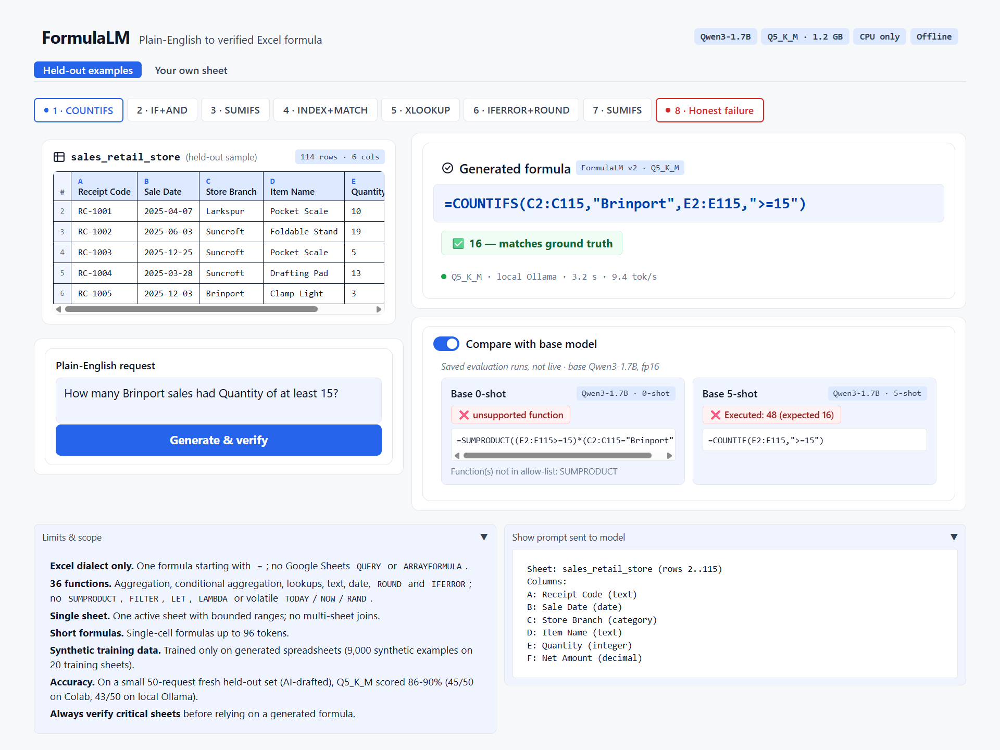
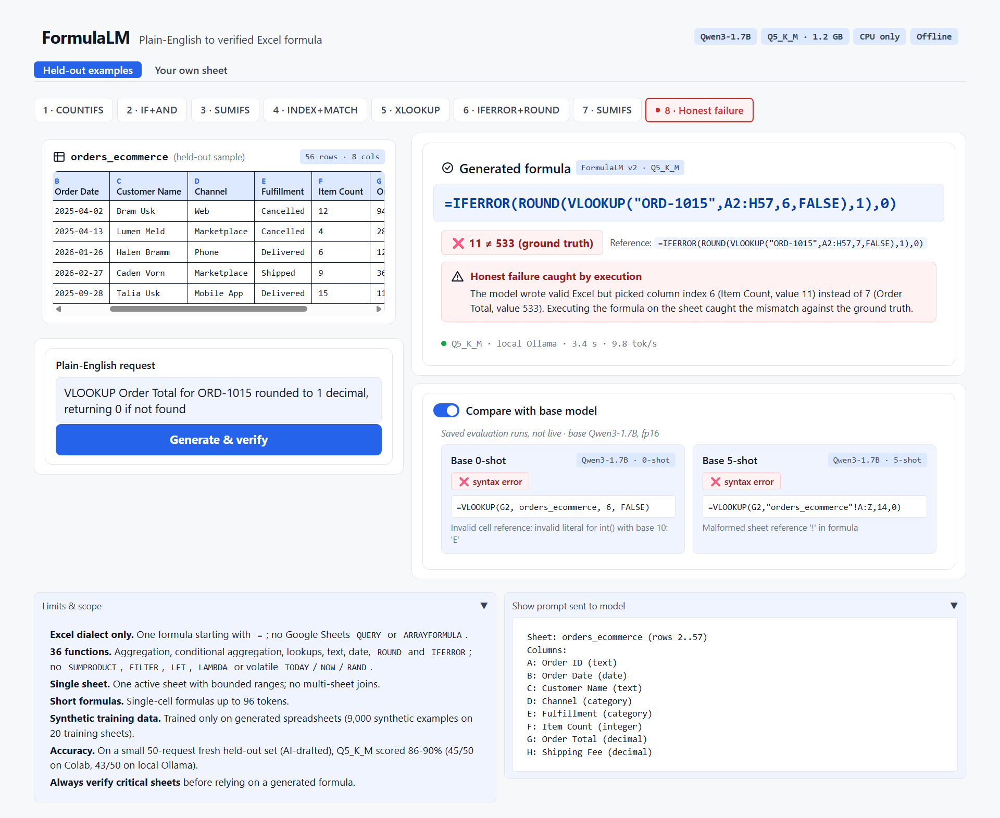
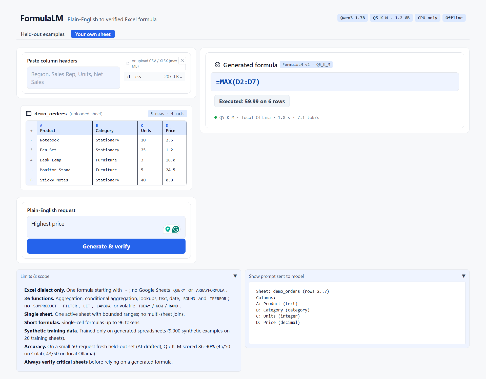

# FormulaLM

- **Author:** Abu Bakar ([@abubakarp789](https://github.com/abubakarp789); Hugging Face & ModelScope: `abubakar56`)
- **Repository:** [github.com/abubakarp789/FormulaLM](https://github.com/abubakarp789/FormulaLM) (`MIT` code & synthetic data)
- **Models (`Apache-2.0`):**
  - Hugging Face: [GGUF (`Q5_K_M` shipped)](https://huggingface.co/abubakar56/formulalm-qwen3-1.7b-gguf) · [v2 LoRA](https://huggingface.co/abubakar56/formulalm-qwen3-1.7b-lora-v2) · [v1 LoRA fallback](https://huggingface.co/abubakar56/formulalm-qwen3-1.7b-lora)
  - ModelScope: [GGUF (`Q5_K_M` shipped)](https://www.modelscope.ai/models/abubakar56/formulalm-qwen3-1.7b-gguf) · [v2 LoRA](https://www.modelscope.ai/models/abubakar56/formulalm-qwen3-1.7b-lora-v2) · [v1 LoRA fallback](https://www.modelscope.ai/models/abubakar56/formulalm-qwen3-1.7b-lora)
- **Demo video:** [Watch local demo on X](https://x.com/abubakarp56/status/2126392963379179557)

## What it does

FormulaLM is a QLoRA-tuned, `Q5_K_M`-quantized `Qwen/Qwen3-1.7B` model (non-thinking mode) that takes a spreadsheet schema (column letters, headers, types, row bounds) plus a plain-English request and returns a single Excel formula (`=...` only), verified by executing the formula against the workbook. It runs offline on a CPU-only laptop via Ollama and a local Gradio app supporting held-out sheets, CSV/XLSX uploads (`<= 1 MB`), or pasted column headers.

## Why I built it

Spreadsheet users usually know the question they want answered (*"How many Brinport sales had Quantity of at least 15?"*) rather than exact `SUMIFS`, `COUNTIFS`, `INDEX`/`MATCH`, or `XLOOKUP` syntax. Cloud LLMs can write formulas, but real spreadsheets often contain payroll, invoices, student grades, or inventory ledgers that cannot be sent to external APIs. Out of the box, base `Qwen/Qwen3-1.7B` only reaches **46.0% (23/50)** zero-shot and **58.0% (29/50)** five-shot execution accuracy on our fresh held-out set (`test_real_v2`), frequently emitting out-of-scope functions, wrong column letters, or broken syntax. Fine-tuning with QLoRA raises execution accuracy to **86.0%–90.0%** while running in **~1.48 GB RAM** locally on CPU.

## Dataset

- **Source & license:** 100% synthetic (`MIT`), generated with fixed `seed=42` across **25 `.xlsx` sheets** spanning 11 domains (**20 training sheets**, **5 held-out test sheets**: `sales_retail_store`, `hr_employee_roster`, `inventory_stock_movements`, `grades_course_scores`, `orders_ecommerce`), covering **36 non-volatile single-sheet Excel functions** with zero personal or scraped data. See [DATASET_CARD.md](https://github.com/abubakarp789/FormulaLM/blob/main/data/DATASET_CARD.md).
- **Templates & splits:** **60 base formula templates** (plus 2 train-only `IFERROR(ROUND(A/B))` templates added in v2 = 62 in `train_v2`), yielding `train.jsonl` (8,000, v1), **`train_v2.jsonl` (9,000, train sheets only)**, frozen `val.jsonl` (500), frozen `test_synthetic.jsonl` (500 on the 5 held-out sheets + 2 reserved phrasings/template), `data/test_real/test_real_DRAFT.csv` (80 realistic requests), and `data/test_real_v2/test_real_v2.csv` (**50 fresh held-out requests**). Automated tests enforce zero sheet overlap, zero phrasing-template leakage, zero prompt duplicates, and 100% executor ground-truth agreement (`0` dropped rows).
- **Authorship & review caveat:** No model-generated paraphrase augmentation or scraped data was used. Templates, phrasing patterns, sheets, and code were written with an AI coding assistant (Google Antigravity) under Abu Bakar's direction, and both `test_real` and `test_real_v2` were AI-drafted with access to the repository (including the v1 error analysis) and reviewed and approved by Abu Bakar on 26 November 2026. Therefore `test_real_v2` is **small (`N = 50`, 95% Wilson CIs ~17–20 pp wide, roughly `±9 pp`) and not fully independent** — treat it as an indication rather than a precise external benchmark.

## Training

- **Tool, platform & hardware:** `Unsloth 2026.11.10` (`torch 2.14.1+cu130`, `transformers 4.57.6`, `trl 0.22.2`, `peft 0.21.2`, `bitsandbytes 0.50.2`) on free Google Colab **Tesla T4 (`14.56 GB` VRAM)**.
- **Base model & revision:** `Qwen/Qwen3-1.7B` pinned at revision `70d244cc86ccca08cf5af4e1e306ecf908b1ad5e` (`Apache-2.0`), strictly non-thinking mode (`enable_thinking=False`).
- **Method & hyperparameters:** 4-bit QLoRA (`r=16`, `lora_alpha=32`, `lora_dropout=0.0`, all 7 linear projections `q/k/v/o/gate/up/down_proj`), `max_seq_length=512`, `train_on_responses_only=True`, effective batch size 16 (`4 × 4`), `adamw_8bit`, cosine schedule, `seed=42`.
  - **`qlora_v1` (`v1-frozen`):** 2 epochs (1,000 steps), `lr=2e-4`, **34.6 min** (`2,073 s`), peak **1.65 GB VRAM**, best `checkpoint-200` (`val_loss = 0.004240`).
  - **`qlora_v2` (`v2-ship`, shipped):** 1 epoch (563 steps), `lr=1e-4`, `weight_decay=0.05`, `warmup_ratio=0.08`, `eval_steps=50`, **19.0 min** (`1,138 s`), peak **4.19 GB VRAM**, best `checkpoint-400` (`val_loss = 0.003975`).
- **Merge & GGUF export:** `v2-ship` adapter merged explicitly into fp16 `Qwen/Qwen3-1.7B@70d244cc` and quantized with `llama.cpp` `b12728`. Prompt-format parity check (`20` fixed examples) confirmed **20/20 (100.0%)** exact output agreement between HF Merged FP16 and GGUF F16.

## Run it locally

- **Tested hardware & runtime:** Windows 11 laptop, **Intel Core i5-8365U, 8 GB RAM, CPU-only (no GPU)**, `Ollama 0.40.18`.
- **Artifact footprint (`Q5_K_M`):** **1,199.6 MB (~1.20 GB)** on disk, **2.64 s** load time, **1,476.5 MB (~1.48 GB)** peak RAM, **11.3 tok/s**, `num_ctx 2048`, `num_predict 96`, `temperature 0`.
- **System prompt:** `You are FormulaLM. Given a spreadsheet schema and a user request, reply with only the Excel formula starting with '='. No explanation, no markdown.`

```bash
# 1. Download Q5_K_M GGUF (1.20 GB) and Modelfile (Hugging Face — or swap for ModelScope links above)
curl -LO https://huggingface.co/abubakar56/formulalm-qwen3-1.7b-gguf/resolve/main/formulalm-qwen3-1.7b-v2-q5_k_m.gguf
curl -LO https://huggingface.co/abubakar56/formulalm-qwen3-1.7b-gguf/resolve/main/Modelfile

# 2. Register in Ollama and run in non-thinking mode (--think=false)
ollama create formulalm -f Modelfile
ollama run --think=false formulalm $'Sheet: sales_retail_store (rows 2..115)\nColumns:\nA: Receipt Code (text)\nB: Sale Date (date)\nC: Store Branch (category)\nD: Item Name (text)\nE: Quantity (integer)\nF: Net Amount (decimal)\n\nRequest: Total Net Amount for the Mirehaven branch'
# Output: =SUMIF(C2:C115,"Mirehaven",F2:F115)  (executes to 10205.82)
```

Optional local Gradio UI: `git clone https://github.com/abubakarp789/FormulaLM.git && cd FormulaLM && uv sync && .\scripts\run_demo.ps1`.

## Before and after

Every prediction is validated against an allow-list of 36 non-volatile functions and **executed** in Python `formulas 1.3.4` on the `.xlsx` workbook, then compared to an independent pandas ground truth (`tol=1e-6`). Brackets show 95% Wilson CIs (all numbers from [`results/`](https://github.com/abubakarp789/FormulaLM/tree/main/results)).

### Fresh held-out set (`test_real_v2`, `N = 50`, not fully independent)

| System | Eval Runtime | Exec. Accuracy (`N = 50`) | Exact Match | Syntax Valid |
|---|---|---:|---:|---:|
| Base `Qwen3-1.7B` (0-shot, fp16) | Colab T4 | **46.0%** (23/50, `[33.0%, 59.6%]`) | 40.0% | 76.0% |
| Base `Qwen3-1.7B` (5-shot, fp16) | Colab T4 | **58.0%** (29/50, `[44.2%, 70.6%]`) | 46.0% | 88.0% |
| Fine-tuned v1 (`v1-frozen`, fp16) | Colab T4 | **88.0%** (44/50, `[76.2%, 94.4%]`) | 82.0% | 100.0% |
| Fine-tuned v2 (`v2-ship`, fp16) | Colab T4 | **88.0%** (44/50, `[76.2%, 94.4%]`) | 86.0% | 100.0% |
| **v2 `Q5_K_M` GGUF (Shipped)** | Colab `llama-server` | **90.0%** (45/50, `[78.6%, 95.7%]`) | 88.0% | 100.0% |
| **v2 `Q5_K_M` GGUF (Shipped)** | **Local CPU Ollama** | **86.0%** (43/50, `[73.8%, 93.0%]`) | 84.0% | 100.0% |

### Quantization & Local CPU Benchmark (`v2-ship`, Windows 11 i5-8365U 8 GB CPU-only)

\* *`test_real` (`N=80`) and `test_synthetic` (`N=500`) for `v2` are informed by v1 error analysis.*

| Quant | Size (MB) | Colab `val` (500) | Colab `test_real_v2` (50) | Colab `test_real` (80)\* | Colab `test_synthetic` (500)\* | Local Load | Local Peak RAM | Local Speed | Local 130-ex (`real`+`real_v2`) |
|---|---:|---|---|---|---|---:|---:|---:|---|
| `F16` *(ref)* | 3,287.7 | 99.8% | 88.0% | 93.8% | 98.8% | — | — | — | — |
| `Q8_0` | 1,749.5 | 99.8% | 86.0% | 93.8% | 98.6% | 5.93 s | 2,026.4 MB | 7.8 tok/s | 91.5% (119/130) |
| **`Q5_K_M` (Shipped)** | **1,199.6** | **99.6%** | **90.0%** | **93.8%** | **98.4%** | **2.64 s** | **1,476.5 MB** | **11.3 tok/s** | **90.8% (118/130)** |
| `Q4_K_M` | 1,056.1 | 97.4% | 90.0% | 88.8% | 95.4% | 4.60 s | 1,333.0 MB | 12.7 tok/s | 89.2% (116/130) |

### Same held-out prompt example (`real_v2_005`, `sales_retail_store`)

- **Prompt:** `Request: How many Brinport sales had Quantity of at least 15?` (with `sales_retail_store` schema `A..F`, rows `2..115`)
- **Base `Qwen3-1.7B` (0-shot):** `=SUMPRODUCT((E2:E115>=15)*(C2:C115="Brinport"))` → `unsupported_function`
- **Base `Qwen3-1.7B` (5-shot):** `=COUNTIF(E2:E115,">=15")` → executes to `48` (dropped branch filter; expected `16`)
- **FormulaLM `Q5_K_M` (local Ollama):** `=COUNTIFS(C2:C115,"Brinport",E2:E115,">=15")` → executes to **`16`** (`= ground truth`)

### Honest failure & limitations

- **Concrete failure (`real_v2_050`, `orders_ecommerce`):** Asked to `VLOOKUP` `Order Total` for `ORD-1015`, `Q5_K_M` outputs valid syntax `=IFERROR(ROUND(VLOOKUP("ORD-1015",A2:H57,6,FALSE),1),0)` but picks column index `6` (`Item Count` → **`11`**) instead of `7` (`Order Total` → **`533`**). Execution catches this immediately. Other local errors include inequality direction (`real_v2_029`) and abbreviated category names (`"<>C"` vs `"<>Sec C"` on `real_v2_034`).
- **Scope limits:** Excel dialect only, 36 non-volatile single-sheet functions (`<= 96` tokens), synthetic training data only, and small `N = 50` non-independent held-out set.





## What we learned

- **1 epoch at `lr=1e-4` stopped overfitting:** `v1` peaked at `checkpoint-200` (`val_loss = 0.004240`) and overfit past `checkpoint-200` through Epoch 2 (`train_loss -> 0.0000`, `val_loss` rebounding to `0.0095` at step 300 and `0.0086` at step 1000). `v2` lowered `val_loss` to `0.003975` in 19.0 min, though `v1` and `v2` remain statistically tied (`44/50` fp16 on `test_real_v2`, `498/500` on `val`).
- **Quantization choice matters on formulas:** `Q4_K_M` dropped `2.4–5.0 pp` vs `F16` (`-2.4 pp` val, `-3.4 pp` synthetic, `-5.0 pp` `test_real`), whereas `Q5_K_M` stayed within `-0.4 to +2.0 pp` (sampling noise) for only `+143.5 MB`.
- **What remains uncertain:** Local CPU Ollama and Colab CUDA `llama-server` differed by 2 examples on `test_real_v2` (`43/50` vs `45/50`), and true real-world accuracy needs an independently human-authored workbook benchmark.

## Team

- **Abu Bakar** — [@abubakarp789](https://github.com/abubakarp789) (Hugging Face & ModelScope: `abubakar56`). Solo participant: conceived the project, defined scope and evaluation, ran all training/eval/quantization/local CPU benchmarks, published the models, and reviewed and approved all code, synthetic data, test sets, and results. An AI coding assistant (Google Antigravity) was used under his direction to help write code, synthetic templates/sheets, and draft test requests.
- **Credits:** Qwen Team (`Qwen/Qwen3-1.7B`), Unsloth, Junaid Shaukat & Qwen Pakistan ([`junaiddshaukat/finetune-anywhere`](https://github.com/junaiddshaukat/finetune-anywhere)), `llama.cpp`, Ollama, `formulas`, and Gradio. Code & synthetic data: `MIT`; model adapters & GGUF weights: `Apache-2.0`.
