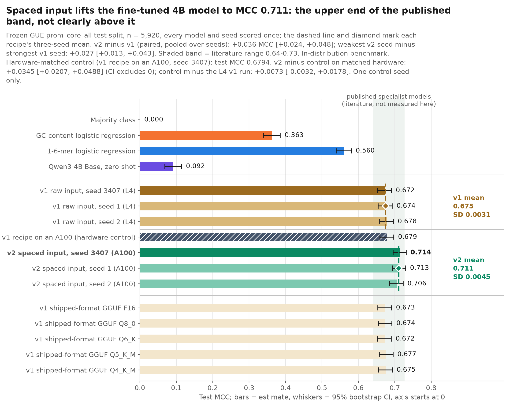
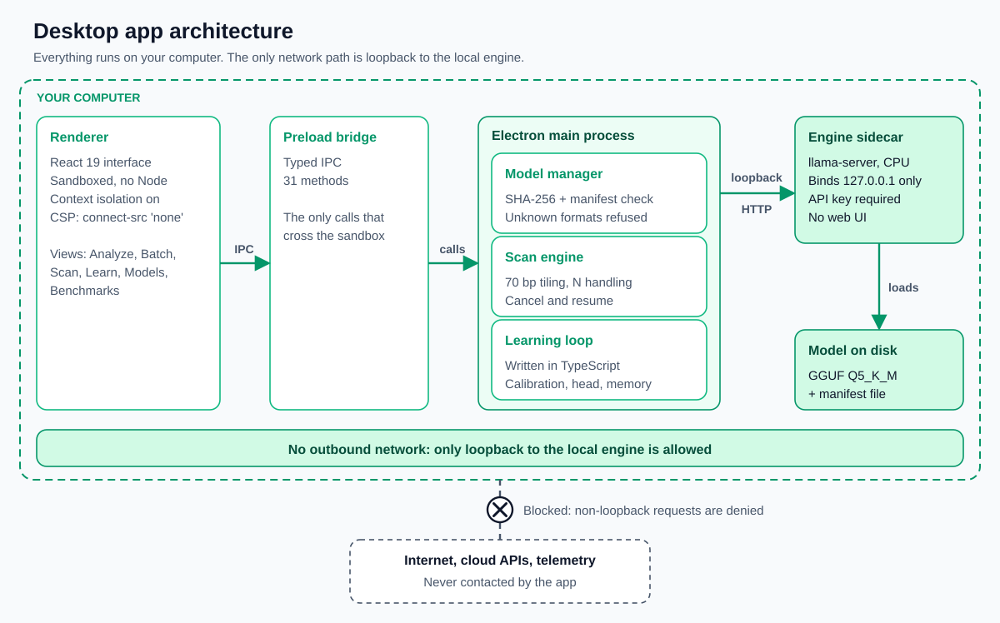
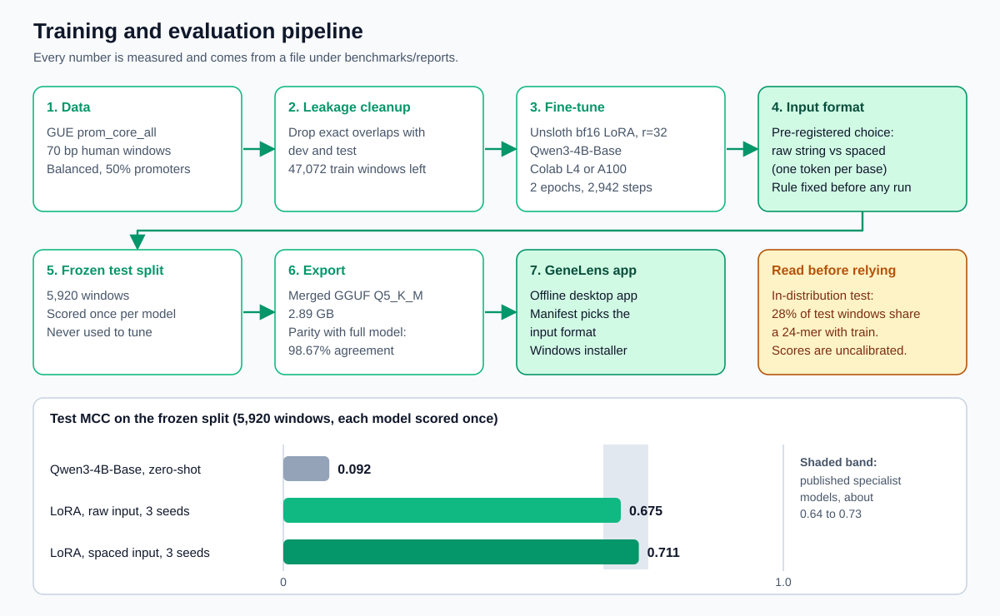

# GeneLens-Qwen

**A DNA specialist that runs on your own laptop, offline.** A Qwen3-4B-Base fine-tuned with Unsloth LoRA to recognise human
core promoters, exported to a 2.89 GB GGUF, and wrapped in a private desktop app.

> Research use only. Not a medical device.

| | |
|---|---|
| Model (weights, adapters, GGUF) | https://huggingface.co/OsamaAli313/genelens-qwen3-4b-promoter |
| Code, app, tests, benchmarks | https://github.com/Osamaali313/genelens-qwen |
| Headline result | test MCC **0.711** (3 seeds) vs **0.092** for the same base model zero-shot |
| Where that sits | upper end of the published 64 to 73 range, **not clearly above it** |
| Runs on | a normal laptop CPU, no GPU, no network |



## What it does

Paste a 70 bp stretch of human DNA and GeneLens answers `1` (core promoter) or `0`, with a score. The desktop app adds
long-sequence scanning (any length, tiled into 70 bp windows, with a cost estimate before it runs and BED export), batch
analysis of up to 5,000 sequences, and a local learning loop that improves outputs from your own labels **only if it beats the
original on held-out data**. Nothing leaves the machine: no telemetry, no cloud fallback, and the engine listens on loopback only.

| User | Story |
|---|---|
| Student | "I paste a sequence and see how a specialist model reads it, with honest caveats." |
| Bioinformatician | "I scan a candidate region, see where the model gets interested, and export a BED file." |
| Privacy-constrained researcher | "My sequence is unpublished. I need it analysed without it leaving my computer." |

## Why we built it

A general language model is the wrong tool for this narrow task: used as-is, the base model scores MCC 0.092, close to chance.
And pasting unpublished sequence into a hosted service is often not allowed. So we fine-tuned a small model for one job, measured
it carefully, and made it run locally. It is a **specialist, not a chatbot**, and not a competitor to general assistants.

This is also the prototype of a larger mission: a pipeline for sequences longer than 2,000 bp. The Scan view is its first step.



## Dataset

| | |
|---|---|
| Source | GUE `prom_core_all` (DNABERT-2 benchmark suite): human core promoters vs not, 70 bp windows, balanced |
| Train | 47,072 windows after removing exact overlaps with dev and test |
| Dev / test | 5,903 dev; 5,920 frozen test windows, each model scored **once** (an access log is enforced by a test) |
| Licence | GUE has no stated licence, so the data is **not redistributed**. Rebuild scripts are in the repo. |

## Training

| | |
|---|---|
| Tool and platform | Unsloth on Google Colab (raw recipe: L4, 84 min; spaced recipe: A100 40 GB, about 30 min) |
| Method | bf16 LoRA, r=32, alpha=32, 7 projection modules (66.1M trainable of 4.09B parameters) |
| Optimiser | `adamw_8bit`, lr 2e-4 cosine, batch 32, 2 epochs (2,942 steps), seed 3407 |
| Loss | cross-entropy on the single answer token (prompt masked) |
| Software | Unsloth 2026.11.12, transformers 4.57.6, trl 0.22.2, peft 0.21.2, torch 2.14.1 |
| Export | merged GGUF, Q5_K_M, llama.cpp b12359 |



**The one change that mattered** was found by a single candidate **pre-registered before any run**: write the DNA one token per
base (`A C G T ...`) instead of one string. Nothing else changed.

| System (test split, 5,920 windows) | MCC [95% CI] |
|---|---|
| Majority class | 0.000 |
| 1 to 6-mer logistic regression | 0.560 [0.539, 0.581] |
| Qwen3-4B-Base, zero-shot | 0.092 [0.069, 0.115] |
| LoRA, raw string input (3 seeds, mean) | 0.675 (0.672 / 0.674 / 0.678) |
| **LoRA, spaced input (3 seeds, mean)** | **0.711** (0.714 / 0.713 / 0.706) |

A control retrained on the same A100 shows the gain is the input format, not the hardware (+0.035 [+0.021, +0.049]).

## Run it locally

```bash
hf download OsamaAli313/genelens-qwen3-4b-promoter --include "spaced/gguf/*" --local-dir genelens
llama-server -m genelens/spaced/gguf/genelens-qwen3-4b-promoter-v2-spaced-Q5_K_M.gguf -c 2048 --port 8080
```

Prompt (no chat template, no trailing space or newline after `Label:`; DNA one token per base):

```
Task: classify a 70 bp human DNA sequence. 1 = core promoter, 0 = not a core promoter.
Research use only; not a medical diagnosis.
Sequence: T G T C C T A A T A A G G G A A G C A A G A A G T G T A T T T A T C A C A G A C A T G A A A G C T A A C C G A G G A C T T G A G A G A C T C
Label:
```

```bash
curl http://127.0.0.1:8080/completion -d '{"prompt":"<the prompt above>","n_predict":1,"temperature":1.0,
  "samplers":["temperature"],"logit_bias":[[15,100],[16,100]],"n_probs":2,"post_sampling_probs":true}'
```

Runtime: llama.cpp, Q5_K_M, 2.89 GB, runs on CPU (about 3 to 6 s per window on an Intel i5-10400H laptop with 31 GB RAM, no GPU).
The Windows desktop app installer is on the GitHub releases page; it is unsigned (SmartScreen will warn).

## Before and after

Same prompt, same readout, public sequence from **outside** GUE (human genome GRCh38 via Ensembl, checked to share no 24-mer
with any training, dev or test window).

| Window | Truth (annotation) | Base Qwen3-4B-Base | GeneLens |
|---|---|---|---|
| FOXP2 promoter (annotated TSS, -34 to +35) | promoter | `0`, P("1") 0.41, wrong | **`1`, P("1") 0.64, right** |
| FOXP2 intron (3 kb inside the gene) | not a promoter | `0`, P("1") 0.35, right | **`0`, P("1") 0.08, right** |
| SOX2 promoter (annotated TSS) | promoter | `0`, P("1") 0.41, wrong | `0`, P("1") 0.27, **wrong** |

The base model's score barely moves (0.35 to 0.41 on every window) and in plain generation it just continues the prompt template.
The tuned model separates the FOXP2 pair and **misses the SOX2 promoter**; we leave that in. Three windows are an illustration, not
evidence; the evidence is the 5,920-window benchmark above. Details: `docs/BEFORE_AFTER.md` in the GitHub repo.

## Limits we state plainly

* In-distribution benchmark (about 28% of test windows share a 24-mer with training, and the model is worse on those). No claim
  about new loci or species.
* Scores are a two-token softmax, **not calibrated probabilities**. At genome-scale base rates expect many false positives:
  scanning two real 2,100 bp gene regions, 64% (FOXP2) and 47% (SOX2) of windows scored 0.5 or more, and the SOX2 start-site
  windows scored 0.05. Calls are candidates, not annotations.
* CPU speed (3 to 6 s per window) is not genome scale yet; GPU offload is the next step.
* The spaced model is about 1.2x slower and weaker off its 70 bp training length.
* GUE data licence is unstated: resolve before any commercial use.
* The installer is unsigned and the macOS build has never been run. Frontier chat models were not tested.

## What we learned

* **What helped:** a single pre-registered change (one token per base), seeds and a hardware-matched control to separate the
  effect from noise, and scoring the frozen test split once per model.
* **What failed and stayed on the record:** a multi-task model over 27 GUE tasks. Two attempts never learned (stopped by a rule
  written in advance); the third beat a k-mer baseline on 17 of 27 dev tasks but **failed its non-inferiority rule** on the 70 bp
  promoter task, so it is not in the app and its test split was deliberately not scored. Putting labelled examples inside the
  prompt made results worse in every arm (-0.11 to -0.30 MCC).
* **What remains uncertain:** why the spaced format helps (hypothesis: one token per base gives cleaner units), and how any of this
  transfers to genome-scale scans.

## Tested

447 TypeScript tests, 97 Python tests, a 28-check engine stress suite, a real-window UI, layout and failure-mode suites on the
installed Windows build, an independent security review with findings fixed, and every reported metric re-derived independently
from raw predictions. See `docs/TESTING.md` in the GitHub repo.

## Team

* Syed Osama Ali Shah ([@Osamaali313](https://github.com/Osamaali313))

Credits: Qwen3 (Apache-2.0), Unsloth, llama.cpp, Electron, the DNABERT-2 GUE benchmark (Zhou et al., 2023) and EPDnew.
