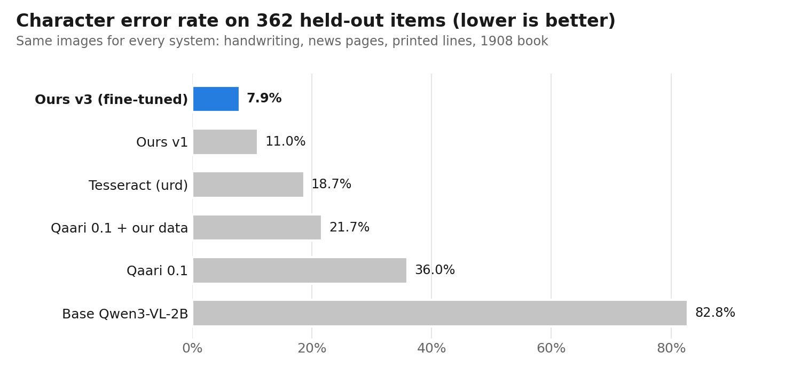
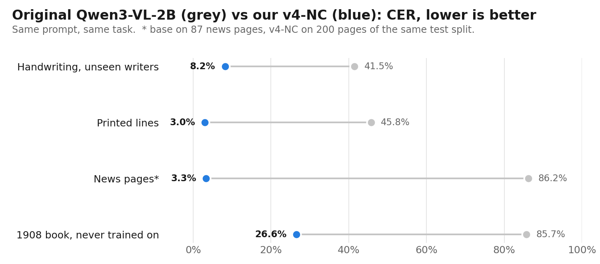
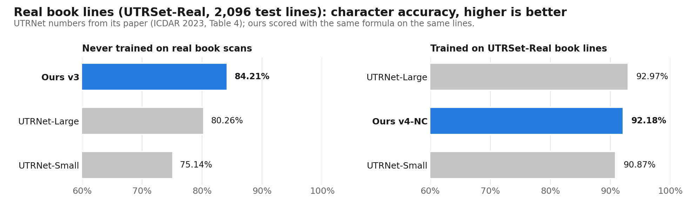
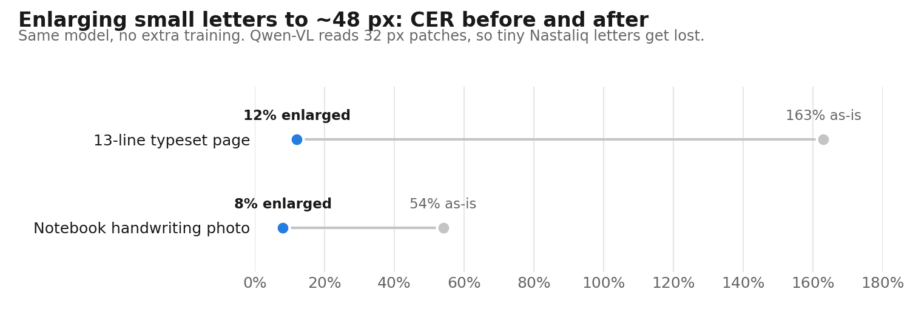
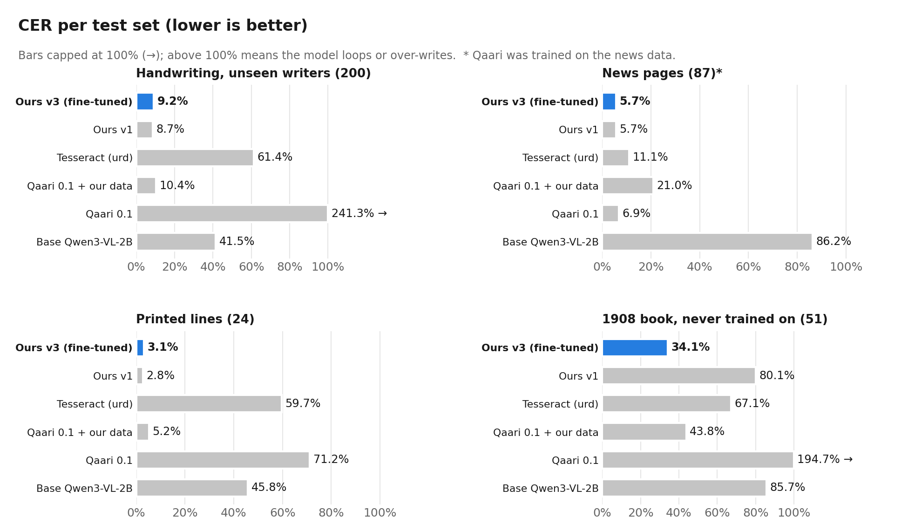
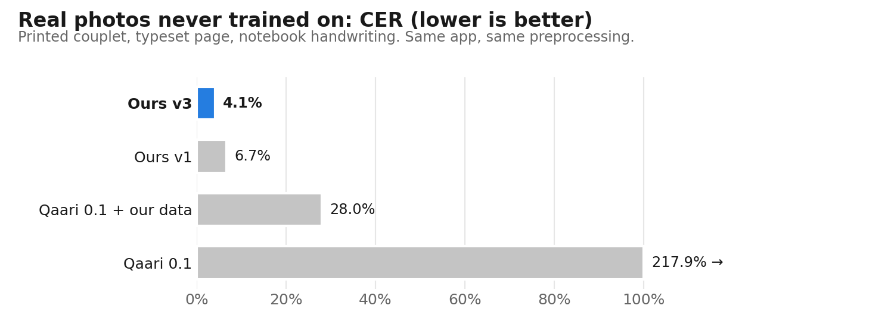

# Urdu Nastaliq OCR: Qwen3-VL-2B, fine-tuned and running offline

**Photo of Urdu in, editable Urdu text out, on a CPU, with no internet and no API key.**
A 2B vision model taught one hard job: reading Nastaliq, the joined, sloping script that most OCR tools break on.

| | |
|---|---|
| **Model** | [OmgItsAmmer/urdu-nastaliq-ocr-qwen3vl-2b-GGUF](https://huggingface.co/OmgItsAmmer/urdu-nastaliq-ocr-qwen3vl-2b-GGUF) (GGUF Q8_0 1.8 GB / Q4_K_M 1.1 GB + LoRA adapter) |
| **Code** | [`code/`](code/): data, training, evaluation, GGUF export, web app |
| **Runs on** | llama.cpp, CPU only, 5.6 GB RAM peak |
| **Team** | Ammer Saeed ([@OmgItsAmmer](https://github.com/OmgItsAmmer)), Mehreen ([@meh5REeen](https://github.com/meh5REeen)) |

## The result in one picture

<picture>
  <source media="(prefers-color-scheme: dark)" srcset="charts/cer-overall-dark.png">
  
</picture>

- **Handwriting from writers it never saw:** errors drop from 41% to 8%; wrong words from 77% to 26%.
- **Printed lines:** 46% to 3%. **News pages:** 86% to 3%. **A book from 1908:** three times fewer errors.
- **Real book lines (UTRSet-Real, 2,096 lines): 92% accuracy**, within a point of the specialised UTRNet-Large, after an 80-minute final training round.
- **Beats the existing open Urdu OCR model** (Qaari 0.1) and Tesseract on the same images.
- Runs on a normal computer, **no GPU, no internet**: about 3 s a line, under a minute a page, from a 1.8 GB GGUF.

## Our best model, v4-NC: the numbers in the demo video

Four LoRA rounds, each continuing the last: **v1** (synthetic lines, news pages, handwriting), **v2** (photo-style re-renders),
**v3** (second typeface), and **v4-NC**, which adds about 9k real scanned book lines from UTRSet-Real
(UTRNet, ICDAR 2023) while replaying the older data so nothing is forgotten. The final round took **82 minutes**
(1 epoch, 556 steps) on one RTX 3090.

<picture>
  <source media="(prefers-color-scheme: dark)" srcset="charts/base-vs-v4nc-dark.png">
  
</picture>

| Test (CER / WER %, lower is better) | Original Qwen3-VL-2B | **v4-NC** |
|---|---:|---:|
| Handwriting, unseen writers (200) | 41.5 / 77.1 | **8.2 / 26.5** |
| Printed Nastaliq lines | 45.8 / 79.0 | **3.0 / 14.4** |
| News pages | 86.2 / 96.5 | **3.3 / 4.0** |
| 1908 book scan, never trained on (51) | 85.7 / 114.1 | **26.6 / 65.9** (3.2x fewer errors) |
| Real book lines, UTRSet-Real test (2,096) | | **8.05 CER = 92.18% accuracy** |

Handwriting and the 1908 book use identical items for both models. For news and printed lines the original ran on
87 and 24 items and v4-NC on 200 of each, from the same test splits. On the identical 87 news pages, v3 scores 5.7%.

### Against UTRNet, the specialised Urdu OCR network

<picture>
  <source media="(prefers-color-scheme: dark)" srcset="charts/utrnet-dark.png">
  
</picture>

- **Without real book scans:** our v3 (84.21%) leads both UTRNet models trained on synthetic data (Small 75.14%, Large 80.26%).
- **With real book lines:** v4-NC (92.18%) beats UTRNet-Small (90.87%) and is within a point of UTRNet-Large (92.97%).
- UTRNet numbers are from the paper's Table 4 (Rahman, Ghosh & Arora, ICDAR 2023, arXiv 2306.15782); ours use the same
  character-accuracy formula on the same 2,096 lines. UTRNet trains on UTRSet only; v4-NC also replays our other data.

### Same image, every model

A printed Ghalib couplet photo (16 words), never trained on: کیا تنگ ہم ستم زدگاں کا جہان ہے / جس میں کہ ایک بیضۂ مور آسمان ہے

| Model | Words wrong |
|---|---:|
| Qaari 0.1 | 12 of 16 |
| Qaari 0.1 trained on our data | 5 of 16 |
| Ours v3 | 3 of 16 |
| **Ours v4-NC** | **1 of 16** (the two lines come back joined as one) |

### Speed

About **3 s per line and under a minute per page on a CPU** with no GPU (measured, table below). On a phone we
*estimate* 4 to 9 s per line; we have not benchmarked a phone yet.

**Licence:** UTRSet-Real is CC BY-NC-SA 4.0, so v4-NC is a separate research, non-commercial model (credit the UTRNet
authors). The published model below is **v3**, trained only on openly licensed data (Apache 2.0 base, MIT/CC BY/OFL data).

## What it does

You give it a photo or scan of Urdu text: a printed line, a page, or handwriting. It gives back the
text in Urdu script. It runs entirely on a CPU, with no internet and no API key. The model is
Qwen3-VL-2B fine-tuned with LoRA and shipped as GGUF for llama.cpp (Q8_0 1.8 GB, Q4_K_M 1.1 GB).

## Why we built it

Urdu is read by about 230 million people and is mostly written in **Nastaliq**, where letters join
and words slope down to the left. That breaks most OCR tools:

- Tesseract's Urdu model is far off on our handwriting and printed-line tests (see the table).
- Base Qwen3-VL-2B often doesn't stop: it loops until the token limit, so its error rate is over
  100% on pages.
- The released Urdu OCR model we compared against (Qaari 0.1) fails on photos unlike its training
  fonts: it over-writes badly on typeset pages.

A small model taught this one task can beat all three and is cheap enough to run locally, which
keeps private documents on the device.

## How it was built: three rounds

| Round | Added | Examples | Time on 1x RTX 3090 | Peak VRAM (reserved) |
|---|---|---:|---|---|
| **v1** | synthetic Nastaliq lines (one font), news pages, tablet handwriting | 82,670 | 5.4 h | 18.0 GB |
| **v2** | the same data re-rendered as **photos**: handwriting on ruled notebook paper, lines stacked into multi-line pages; continues from v1 | 22,366 | 2.6 h | 17.8 GB |
| **v3** | a **second typeface** (Noto Nastaliq Urdu, OFL) as lines and pages; continues from v2 | 25,569 | 1.9 h | 11.4 GB |

Common setup: `Qwen/Qwen3-VL-2B-Instruct`, LoRA r=32 / alpha=64 on all linear layers (language model and
vision), bf16, batches packed by token budget, max length 2,560 tokens, transformers 5.24, PEFT 0.22,
torch 2.14. v3 final eval loss 0.127 (v2: 0.146). Configs are in `configs/`.

Two findings did most of the work:

1. **Letter size.** Qwen-VL reads images in 32-pixel patches, and Nastaliq letters in small images are
   too small to see. On one 13-line typeset page CER went from **163% (a repeating loop) to about 12%**, and on one
   notebook handwriting photo from **54% to 8%** (single images, scored against our own transcriptions), just by enlarging the image until letters are about 48 px
   tall. We measure letter height from the connected ink blobs (ruled lines removed) and enlarge only
   when needed. No training involved.
2. **Broken letters teach guessing.** About a third of the synthetic source lines are eroded, with
   missing letter pieces, while their labels list every letter. Training on them taught the model to
   guess common words for letters it could not see ("آسمان" became "آسان"). The page data in v2 and v3
   keeps only solid-ink lines.

<picture>
  <source media="(prefers-color-scheme: dark)" srcset="charts/letter-size-dark.png">
  
</picture>

Output cleanup: repeated words (4+ times in a row) or characters (30+ times) are collapsed to one copy. It
changes 0 of 651 reference texts, so it does not touch normal text.

## Data and credits

All training data is openly licensed. Please credit the sources:

| Source | Licence | Used for |
|---|---|---|
| [PuristanLabs1/urdu-ocr-1M](https://huggingface.co/datasets/PuristanLabs1/urdu-ocr-1M) (Nastaliq part) | MIT | synthetic lines; their texts also rendered by us in Noto Nastaliq Urdu |
| [oddadmix Qaari 0.1 news](https://huggingface.co/datasets/oddadmix/qaari-0.1-ocr-urdu-news-dataset-small) | MIT | news pages |
| [OUHD-L online Urdu handwriting](https://huggingface.co/datasets/saad2002/ouhd-l-online-urdu-nastaliq-handwriting), DOI 10.5281/zenodo.20642162 | **CC BY 4.0** | tablet handwriting (311 writers, split by writer), re-rendered as notebook photos |
| [Noto Nastaliq Urdu](https://fonts.google.com/noto/specimen/Noto+Nastaliq+Urdu) | SIL OFL 1.1 | second typeface |
| [UTRSet-Real](https://github.com/abdur75648/UTRNet-High-Resolution-Urdu-Text-Recognition) (UTRNet, ICDAR 2023) | **CC BY-NC-SA 4.0** | v4-NC only: ~9k real scanned book lines; its 2,096-line test split is benchmark only |
| [1908 book sample](https://huggingface.co/datasets/vettedlance/urdu-nastaliq-1908-eval-sample) | evaluation only | **never trained on**; tests old print |

Baselines: Qaari 0.1 ([oddadmix/Qaari-0.1-Urdu-OCR-VL-2B-Instruct](https://huggingface.co/oddadmix/Qaari-0.1-Urdu-OCR-VL-2B-Instruct)),
Tesseract 5 with `urd`. Base model Qwen3-VL (Apache 2.0). Tools: Hugging Face transformers and PEFT,
llama.cpp. Background reading that shaped our approach: Naz et al. 2017; Ul-Hasan et al. 2013; Sabbour and
Shafait 2013 (UPTI); Maqsood et al. (unified printed and handwritten Urdu OCR); Riaz et al. (Conv-Transformer).

## Source code

All the code is in [`code/`](code/): data download and splits (`uocr/data`), LoRA training (`uocr/train`,
`configs/`), CER/WER evaluation against the baselines (`uocr/eval`), LoRA merge and GGUF export
(`uocr/export`, `tools/`), and the web app (`app/`). Setup and commands are in [`code/README.md`](code/README.md).
Datasets, adapters and GGUF weights are not in the repo (see the model link).

## Run it locally

Model: **[OmgItsAmmer/urdu-nastaliq-ocr-qwen3vl-2b-GGUF](https://huggingface.co/OmgItsAmmer/urdu-nastaliq-ocr-qwen3vl-2b-GGUF)** (GGUF files plus the v3 LoRA adapter in `lora-adapter/`).

```
hf download OmgItsAmmer/urdu-nastaliq-ocr-qwen3vl-2b-GGUF urdu-ocr-2b-v3-Q8_0.gguf urdu-ocr-2b-v3-mmproj-f16.gguf --local-dir .
```

### Quickstart: the web app (photo in, text out, copy and read aloud)

```bash
# 1. model (1.8 GB + 0.8 GB vision projector) and a llama.cpp release from github.com/ggml-org/llama.cpp
hf download OmgItsAmmer/urdu-nastaliq-ocr-qwen3vl-2b-GGUF urdu-ocr-2b-v3-Q8_0.gguf urdu-ocr-2b-v3-mmproj-f16.gguf --local-dir models
# 2. start the model on the CPU
llama-server -m models/urdu-ocr-2b-v3-Q8_0.gguf --mmproj models/urdu-ocr-2b-v3-mmproj-f16.gguf --port 8090 -c 8192 -ngl 0 --jinja
# 3. in a second terminal, from code/: the app (enlarges small letters automatically)
pip install fastapi uvicorn python-multipart pillow numpy opencv-python-headless python-dotenv rapidfuzz pyyaml
UOCR_MODELS=ours_gguf UOCR_LLAMA_URL=http://127.0.0.1:8090 uvicorn app.server:app --port 8001
# 4. open http://localhost:8001
```

### Raw llama.cpp

Files: `urdu-ocr-2b-v3-Q8_0.gguf` (1.8 GB, recommended), `urdu-ocr-2b-v3-Q4_K_M.gguf` (1.1 GB) and
`urdu-ocr-2b-v3-mmproj-f16.gguf` (vision projector, needed by both).

```
llama-server -m urdu-ocr-2b-v3-Q8_0.gguf --mmproj urdu-ocr-2b-v3-mmproj-f16.gguf -c 8192 -ngl 0 --jinja
```

Send an image to `/v1/chat/completions` with the prompt: *Read the Urdu text in this image and write
it out exactly, in Urdu script. Keep the original words and punctuation. Output only the text, nothing
else.* with `temperature 0` and `repeat_penalty 1.05`. For best results enlarge small images first so
letters are about 48 px tall (`uocr.pages.prepare_for_reading`). The repo also has a web app that compares
models side by side: `make demo`.

**Measured on CPU only** (Intel i7-13700KF, 8 threads, no GPU, one request at a time):

| | Q8_0 (1.8 GB) | Q4_K_M (1.1 GB) |
|---|---|---|
| RAM, peak | 5.6 GB | 5.6 GB |
| One handwritten line | about 3.5 s | about 2.7 s |
| 1-5 printed lines | about 31 s | about 24 s |
| 13-line typeset page | about 53 s | about 65 s |
| CER on our real photos + test lines (19 items) | 2.8% | 3.5% |

**Also checked on a laptop** (Lenovo Legion, Intel i7-13700HX, 32 GB, CPU only, llama.cpp b12728, 8 threads): the Q8_0 model loads in about 3 s, uses about 3.9 GB of RAM, and reads a scanned 1908 book band in 2 to 17 s depending on how many lines it holds.

Q8_0 gave the same error rate on CPU and GPU on our real-photo check (3.8%). We have not benchmarked phones yet; older laptop CPUs will be slower.

## Results

Character error rate (CER) and word error rate (WER), in percent, lower is better. These are the 362
test items that every system was run on, so the comparison is like for like:

| Test set (items) | Tesseract | Base Qwen3-VL-2B | Qaari 0.1 | Qaari + our data | Ours v1 | **Ours v3** |
|---|---:|---:|---:|---:|---:|---:|
| Handwriting, unseen writers (200) | 61.4 / 96.7 | 41.5 / 77.1 | 241.3 / 282.1 | 10.4 / 31.8 | **8.7** / 27.3 | 9.2 / **27.7** |
| News pages (87) | 11.1 / 17.1 | 86.2 / 96.5 | 6.9 / 8.9 \* | 21.0 / 35.8 | **5.7** / **6.4** | **5.7** / 6.5 |
| Printed lines, synthetic (24) | 59.7 / 90.4 | 45.8 / 79.0 | 71.2 / 107.7 | 5.2 / 22.1 | **2.8** / 20.6 | 3.1 / **18.8** |
| 1908 book, never trained on (51) | 67.1 / 100.9 | 85.7 / 114.1 | 194.7 / 217.1 | 43.8 / 80.7 | 80.1 / 111.0 | **34.1 / 73.2** |
| **All 362** | 18.7 / 29.4 | 82.8 / 96.3 | 36.0 / 43.7 | 21.7 / 38.6 | 11.0 / 15.6 | **7.9 / 13.0** |

<picture>
  <source media="(prefers-color-scheme: dark)" srcset="charts/cer-per-set-dark.png">
  
</picture>

\* Qaari was trained on this news dataset, so that score is not a held-out result.

Caveats on this table: the printed-line row has only 24 items. Our v1 and v3 runs used the letter-size
enlargement described above; the baseline runs did not (the table is not a claim that baselines cannot be
improved the same way). All systems have the repetition cleanup applied. v3's extra training did not improve
handwriting (9.2 vs 8.7) but helped books and printed pages.

Other v3 results on its own larger test sets (CER / WER): Noto-font pages 1.9 / 9.9, stacked printed
pages 6.9 / 23.1, notebook-photo handwriting 11.5 / 32.1. These test sets come from the same generator as
the training data, so they are **optimistic**.

### Real photos: the honest test

Three real images, none ever trained on (a printed Nastaliq couplet, a typeset page, a notebook
handwriting photo), read through the same app with the same preprocessing. CER / WER:

<picture>
  <source media="(prefers-color-scheme: dark)" srcset="charts/cer-real-photos-dark.png">
  
</picture>

| Image | **Ours v3** | Ours v1 | Qaari 0.1 | Qaari + our data |
|---|---:|---:|---:|---:|
| Notebook handwriting | **11.1 / 35.7** | 27.0 / 64.3 | 74.6 / 100.0 | 20.6 / 35.7 |
| Typeset page | **3.7 / 16.3** | 5.5 / 22.0 | 238.6 / 246.9 | 29.6 / 47.4 |
| Printed couplet | **3.2 / 18.8** | 4.8 / 18.8 | 31.7 / 75.0 | 9.5 / 31.2 |
| **All three** | **4.1 / 17.6** | 6.7 / 24.3 | 217.9 / 226.8 | 28.0 / 45.6 |

Three images show a direction, not a guarantee.

### Examples (v3, Q8_0, CPU)

| Image | True text | v3 output | Base Qwen3-VL-2B |
|---|---|---|---|
| held-out printed line | نجیب رزاق نے انگلستان کے اعلیٰ کالجوں سے تعلیم حاصل کی۔ | **exactly right** | تیمیر مسلکِ کے اصل کا بچنے تیزاق نے الگہاتان کے |
| held-out printed line | مرحلہ 7: باقی تمام فلٹر بیگ کے ساتھ 3-6 قدم دہرائیں۔ | مرحلہ7: باقی تمام فلسطر بیگ کے ساتھ 3-6 قدم دہرائیں۔ | مَرْحُلَة 7: باقی تَمَام فَلْسِرِیِ کَے 3-6 تَمَر دِو رَائِتِنَدِي |
| real photo, couplet | کیا تنگ ہم ستم زدگاں کا جہان ہے | کیا تنگ ہم ستم زد گاں کا جان ہے | |
| real photo, notebook | اور ہو سکتا ہو تمہارا یقین تمہیں معجزوں … جب یقین اللہ | اور ہوسکتا ہو تمہارا یقین تمہیں **مجھروں** … **جیہ** یقین اللّہ | |

## Where it still fails

- **About 1 word in 5 is still wrong on real photos** (WER 18-36% on our three), mostly single-letter
  slips: جہان read as جان, معجزوں as مجھروں. When letters are unclear the model falls back on a common
  word, which can change the meaning.
- **Dense old print.** On the 1908 dictionary pages CER is still 34% and WER 73%; the model loops on
  numbered entries.
- **Handwriting beyond neat samples** is not solved. We have only three real images and no labelled
  phone-photo test set of useful size.
- **Dense pages are slow on CPU** (30-60 s), and we have not tested older laptops or phones.
- **Test sets from our own generator flatter us.** Treat the real-photo table as the guide.

## What we learned

- Batching by token count, not example count, is what made full news pages fit in 24 GB.
- Merging LoRA into bf16 weights changed greedy outputs on some lines, so GGUF builds are merged in fp32
  and re-evaluated, not assumed equal. Q8_0 matched PyTorch on our check lines.
- Fine-tuning almost removed the base model's looping; image size and training on solid (not eroded)
  lines removed most of the rest.
- Things that did **not** help: a spelling-correction post-process (CER 8.61% to 8.75%) and llama.cpp's DRY
  anti-repetition sampler (no gain on books, slightly worse on real photos).

## Team

- Ammer Saeed ([@OmgItsAmmer](https://github.com/OmgItsAmmer))
- Mehreen ([@meh5REeen](https://github.com/meh5REeen))
